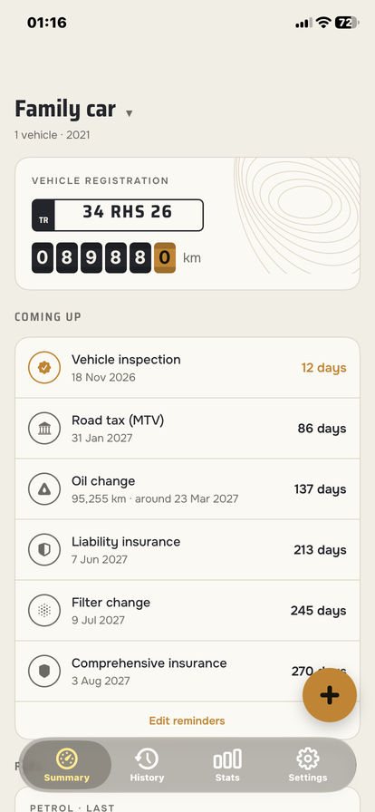
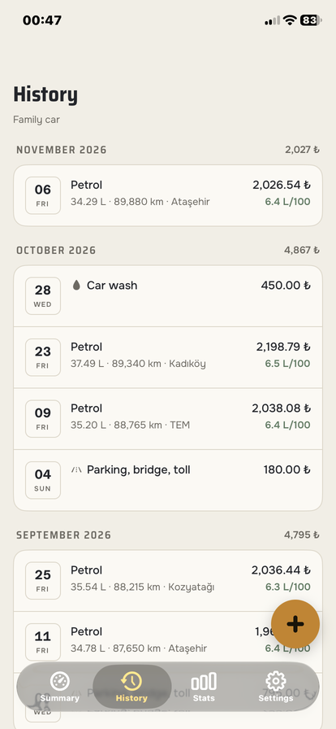
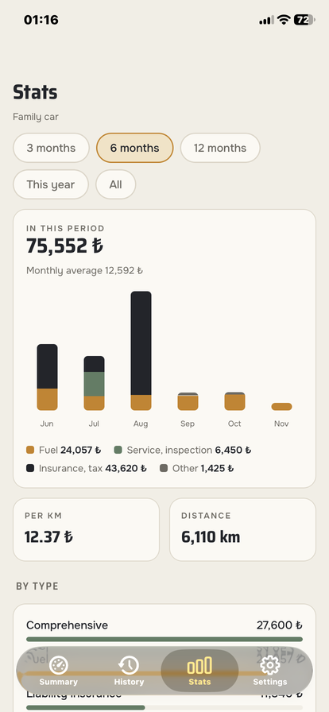
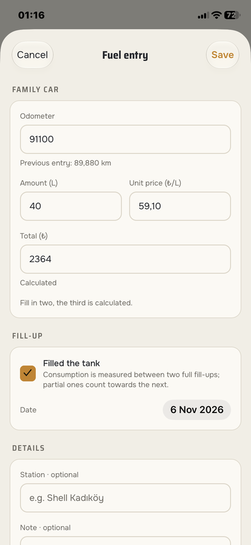
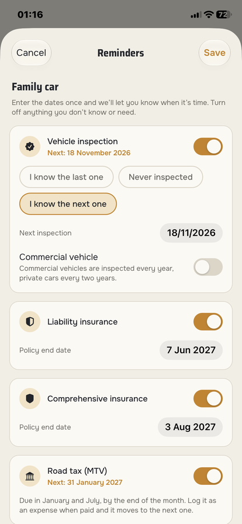
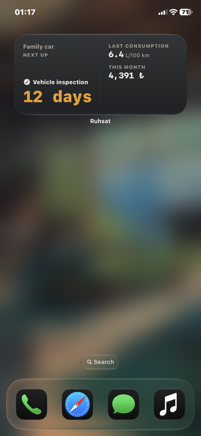

**English** | [Türkçe](README.tr.md)

# Ruhsat: Car Maintenance & Fuel Tracker

Ruhsat is a car maintenance and fuel tracker for iPhone. Log your fill-ups and see your real fuel consumption, keep service and expenses in one place, and get reminders before the vehicle inspection, insurance and road tax (MTV) are due. It works without an account; sign in with a code sent to your email and your entries sync between phones.

## Features

- **No account needed.** Entries are saved on the phone first. Signing in is optional and has no password: you get a 6-digit code by email. Once you sign in, your entries are backed up and synced between phones, and the app keeps working offline.
- **Fuel and consumption:** enter two of litres, total and unit price, and the third is calculated. Consumption is measured from full tank to full tank, so partial fill-ups don't skew it. Petrol and LPG are tracked separately, and impossible values are flagged instead of breaking the average.
- **Service and expenses:** service, inspection, insurance, comprehensive insurance, road tax, fines, parking and tolls, car wash. Tick what was done at a service (oil, filter, tyres, brakes, battery). The odometer you enter updates the car's reading.
- **Reminders that follow Turkish rules:** inspection 3 years after registration and then every 2 years (every year for commercial vehicles), insurance end dates, road tax in January and July, and service by date or by distance. For distance it estimates the day from how much you drive. Logging the related expense moves the next date forward.
- **Stats:** monthly spending by group, consumption chart, cost per km, distance driven and yearly totals, for 3, 6 or 12 months, this year or all time.
- **Home screen widget:** next reminder, last consumption and this month's spending, in small and medium sizes.
- **CSV export** of fuel and expense entries; the file opens in Excel with Turkish characters intact.
- **More than one car**, Turkish plate format check (foreign plates too), make and model suggestions.
- **Light and dark theme, Turkish and English**, three currency formats, and an icon for light, dark and tinted home screens.
- **No locked features.** There is one banner ad, only on the Stats and History screens, and a one-time purchase removes it. Ads are non-personalized.

## Screenshots

| Summary | History | Stats |
|---|---|---|
|  |  |  |

| Fuel entry | Reminders | Widget |
|---|---|---|
|  |  |  |

## Tech Stack

- React Native, Expo and Expo Router (native tabs)
- TypeScript
- SQLite on the phone with Drizzle ORM and migrations (offline-first)
- Supabase: PostgreSQL with row level security, sign-in with an email code (sent through Resend)
- SwiftUI for the home screen widget, added to the Expo project with an App Group
- Google AdMob for the banner and StoreKit for the purchase
- Local notifications with expo-notifications
- React Native Reanimated and react-native-svg (the charts are drawn in the project)
- Jest for the app logic, Node test runner with PGlite for the database rules
- EAS Build and Submit, TestFlight

## Installation

### Run from source

Requires Node.js 24 and an iPhone. Expo Go runs most of the app; the ad, the purchase and the widget need a development build.

```bash
npm ci
cp .env.example .env   # optional: Supabase URL and publishable key, empty = no accounts
npx expo start
```

Development build (needs an Apple Developer account):

```bash
npx eas-cli build --platform ios --profile development
npx expo start --dev-client
```

### Supabase (optional, for accounts and sync)

1. Create a Supabase project and run the files in `supabase/migrations/` in order in the SQL Editor.
2. Under Authentication, turn on the email code (6 digits), use `supabase/templates/code.html` as the email template, and set up an SMTP provider.
3. Put the project URL and the publishable key in `.env`. The secret key is never used in the app.

### Tests

```bash
npm test            # consumption, reminders, stats, sync, validation, translations
npm run test:rls    # row level security rules on a local PGlite database
npm run typecheck
npm run lint
```

## What I Learned

- Building an offline-first app: the phone's SQLite database is the source of truth. Every row has a UUID, an update time, a deletion mark instead of a real delete, and a "not sent yet" flag. Sync sends the changed rows, pulls what changed on the server since the last cursor, and the newer version wins.
- Protecting a shared database with row level security, and testing the rules by breaking them on purpose: the tests fail when a rule is removed.
- Passwordless sign-in with an email code, and account deletion that removes the user and all their rows from the server, as Apple requires.
- Measuring consumption the way drivers expect: from full tank to full tank, with partial fill-ups carried into the next interval and LPG measured on its own.
- Writing date rules (inspection, insurance, road tax, service by distance) as pure functions that I can test without a phone. One lesson: entries are stored at noon, so a range that ended "now" left out this morning's fill-up. Ranges now end at the end of the day.
- Adding a native SwiftUI widget to an Expo app: the app writes a summary to an App Group, and the widget counts the days on its own. A wrong key in the colour settings made the whole widget black.
- Preparing an App Store release: EAS builds, TestFlight, a StoreKit purchase tested in the sandbox, ad consent, and App Review notes with a screen recording. Also that iOS doesn't uppercase Turkish correctly, it wrote VERILERIM instead of VERİLERİM, so I convert i and ı myself.
