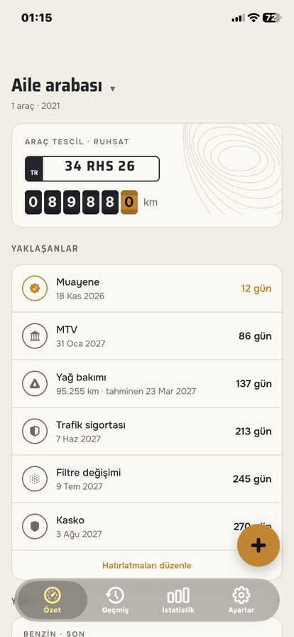
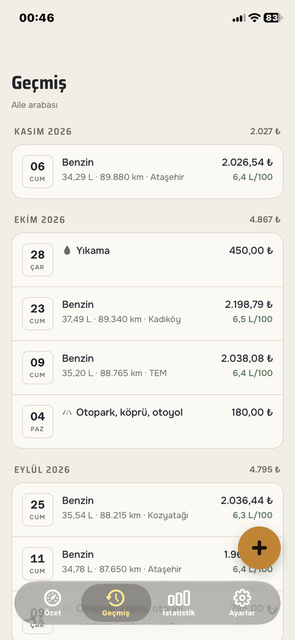
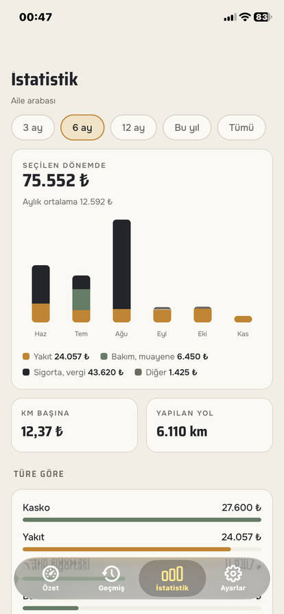
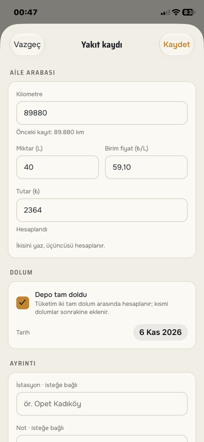
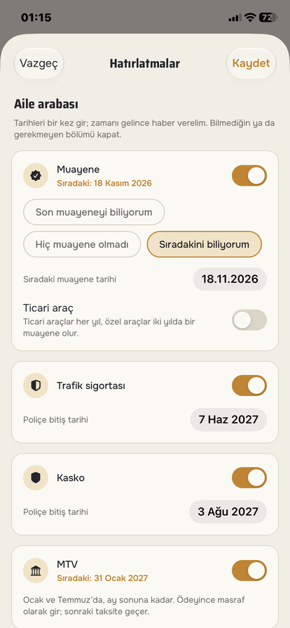
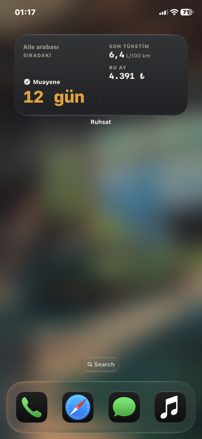

[English](README.md) | **Türkçe**

# Ruhsat: Araç Bakım ve Yakıt Takibi

Ruhsat, iPhone için araç bakım ve yakıt takip uygulaması. Yakıt dolumlarını kaydedip gerçek tüketimini görürsün, bakım ve masrafları tek yerde tutarsın; muayene, sigorta ve MTV zamanı gelmeden hatırlatma alırsın. Hesapsız çalışır; e-postana gelen kodla giriş yaparsan kayıtların telefonlar arasında eşitlenir.

Yakında App Store'da (incelemede).

## Özellikler

- **Hesap şart değil.** Kayıtlar önce telefona yazılır. Giriş isteğe bağlı ve şifresiz: e-postana 6 haneli bir kod gelir. Giriş yapınca kayıtların yedeklenir ve telefonların arasında eşitlenir; uygulama internetsiz de çalışmaya devam eder.
- **Yakıt ve tüketim:** litre, tutar ve birim fiyattan ikisini yazarsın, üçüncüsü hesaplanır. Tüketim tam depodan tam depoya ölçülür, kısmi dolumlar ortalamayı bozmaz. Benzin ve LPG ayrı izlenir; olanaksız değerler ortalamayı bozmak yerine işaretlenir.
- **Bakım ve masraf:** bakım, muayene, trafik sigortası, kasko, MTV, ceza, otopark ve otoyol, yıkama. Bakımda yapılanları işaretlersin (yağ, filtre, lastik, fren, akü). Girdiğin kilometre aracın göstergesini günceller.
- **Türkiye kurallarına göre hatırlatmalar:** muayene trafiğe çıkıştan 3 yıl sonra, sonra 2 yılda bir (ticari araçta her yıl), sigorta ve kasko bitiş tarihleri, Ocak ve Temmuz'da MTV, tarihe ya da kilometreye göre bakım. Kilometrede, ne kadar yol yaptığına bakıp o güne ne zaman geleceğini tahmin eder. İlgili masrafı girince sıradaki tarih ileri gider.
- **İstatistik:** gruplara göre aylık harcama, tüketim grafiği, km başına maliyet, yapılan yol ve yıllık toplamlar; 3, 6 ya da 12 ay, bu yıl ya da tüm zamanlar.
- **Ana ekran widget'ı:** sıradaki hatırlatma, son tüketim ve bu ayki harcama; küçük ve orta boy.
- **CSV dışa aktarma:** yakıt ve masraf kayıtları; dosya Excel'de Türkçe karakterler bozulmadan açılır.
- **Birden fazla araç**, Türk plakası biçim denetimi (yurt dışı plakası da), marka ve model önerileri.
- **Açık ve koyu tema, Türkçe ve İngilizce**, üç para birimi biçimi; açık, koyu ve renkli ana ekranlar için ikon.
- **Kilitli özellik yok.** Yalnızca İstatistik ve Geçmiş ekranlarında tek bir banner reklam var, tek seferlik bir satın almayla kalkar. Reklamlar kişiselleştirilmez.

## Ekran Görüntüleri

| Özet | Geçmiş | İstatistik |
|---|---|---|
|  |  |  |

| Yakıt kaydı | Hatırlatmalar | Widget |
|---|---|---|
|  |  |  |

## Kullanılan Teknolojiler

- React Native, Expo ve Expo Router (yerel sekmeler)
- TypeScript
- Telefonda SQLite, Drizzle ORM ve göçlerle (çevrimdışı öncelikli)
- Supabase: satır düzeyinde güvenlikli (RLS) PostgreSQL, e-posta koduyla giriş (Resend üzerinden)
- Ana ekran widget'ı için SwiftUI; Expo projesine App Group ile eklendi
- Banner için Google AdMob, satın alma için StoreKit
- expo-notifications ile yerel bildirimler
- React Native Reanimated ve react-native-svg (grafikler projede çizildi)
- Uygulama mantığı için Jest, veritabanı kuralları için PGlite ile Node test çalıştırıcısı
- EAS Build ve Submit, TestFlight

## Kurulum ve Çalıştırma

### iPhone

Yakında App Store'da.

### Kaynaktan çalıştırma

Node.js 24 ve bir iPhone gerekir. Uygulamanın çoğu Expo Go'da çalışır; reklam, satın alma ve widget için geliştirme derlemesi gerekir.

```bash
npm ci
cp .env.example .env   # isteğe bağlı: Supabase adresi ve publishable anahtar, boşsa hesap yok
npx expo start
```

Geliştirme derlemesi (Apple Developer hesabı gerekir):

```bash
npx eas-cli build --platform ios --profile development
npx expo start --dev-client
```

### Supabase (isteğe bağlı, hesap ve eşitleme için)

1. Bir Supabase projesi aç, `supabase/migrations/` içindeki dosyaları sırayla SQL Editor'de çalıştır.
2. Authentication'da e-posta kodunu (6 hane) aç, e-posta şablonu olarak `supabase/templates/code.html` dosyasını kullan ve bir SMTP sağlayıcısı bağla.
3. Proje adresini ve publishable anahtarı `.env` dosyasına yaz. Gizli (secret) anahtar uygulamada hiç kullanılmaz.

### Testler

```bash
npm test            # tüketim, hatırlatmalar, istatistik, eşitleme, doğrulama, çeviriler
npm run test:rls    # satır düzeyinde güvenlik kuralları, yerel PGlite veritabanında
npm run typecheck
npm run lint
```

## Öğrendiklerim

- Çevrimdışı öncelikli bir uygulama kurmayı: asıl kaynak telefondaki SQLite veritabanı. Her satırın bir UUID'si, güncellenme zamanı, gerçekten silmek yerine silindi işareti ve "henüz gönderilmedi" bayrağı var. Eşitleme değişen satırları gönderiyor, son imleçten beri sunucuda değişenleri çekiyor; hangi sürüm daha yeniyse o kalıyor.
- Ortak bir veritabanını satır düzeyinde güvenlikle (RLS) korumayı ve kuralları bilerek bozarak test etmeyi: bir kural kaldırılınca testler düşüyor.
- E-posta koduyla şifresiz girişi, ve Apple'ın istediği gibi kullanıcıyı ve bütün satırlarını sunucudan silen hesap silmeyi.
- Tüketimi sürücünün beklediği gibi ölçmeyi: tam depodan tam depoya, kısmi dolumlar sonraki aralığa taşınarak, LPG ayrı.
- Tarih kurallarını (muayene, sigorta, MTV, kilometreye göre bakım) telefonsuz test edebildiğim saf fonksiyonlar olarak yazmayı. Bir ders: kayıtlar günün öğlesine yazılıyor, bu yüzden "şu an"da biten aralık sabahki dolumu dışarıda bırakıyordu. Aralıklar artık günün sonunda bitiyor.
- Bir Expo uygulamasına SwiftUI ile yerel widget eklemeyi: uygulama özeti App Group'a yazıyor, widget günleri kendisi sayıyor. Renk ayarlarındaki yanlış bir anahtar widget'ın tamamını siyah gösteriyordu.
- App Store'a çıkarmayı: EAS derlemeleri, TestFlight, sandbox'ta denenen StoreKit satın alması, reklam onayı, ekran kaydıyla App Review notları. Bir de iOS'un Türkçe büyük harfi doğru yapmadığını ("VERILERIM"), i ve ı'yı kendim çevirmem gerektiğini.
